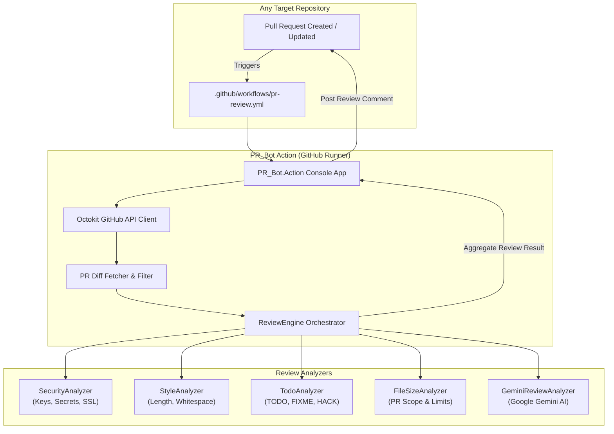

# 🤖 Universal GitHub PR Review Bot

A reusable, serverless, automated Pull Request review bot built in **C# (.NET 10)** that works on **any GitHub repository**. It combines static security and code quality checks with **Google Gemini AI** code reviews — running directly inside **GitHub Actions** with **zero server infrastructure**.

---

## 🌟 Features

- **🌐 Universal Reusability:** Call it from any repo using a simple GitHub Actions workflow file (`uses: YOUR_USERNAME/PR_Bot@main`).
- **🧠 AI-Powered Code Review:** Powered by **Google Gemini** (`gemini-3.5-flash` or any Gemini model) to detect logic bugs, unhandled edge cases, performance bottlenecks, and design anti-patterns.
- **🛡️ Built-in Security Analysis:** Scans added lines for leaked private keys, API keys, tokens, hardcoded passwords, plaintext DB connection strings, and SSL verification bypasses.
- **🎨 Code Style & Quality Rules:** Enforces maximum line lengths, detects trailing whitespace, and alerts on leftover technical debt (`TODO`, `FIXME`, `HACK`).
- **📊 Scope Awareness:** Warns when pull requests are too large or single files add excessive lines of code.
- **⚡ Zero Infrastructure:** Runs on GitHub-hosted runners using the built-in `GITHUB_TOKEN`. No webhooks to configure, no Docker containers to maintain, no cloud bills.

---

## 🚀 How to Use in Any Repository (2 Minutes Setup)

### Step 1: Add your Gemini API Key Secret (Optional, for AI Review)
1. Get a free API key from [Google AI Studio](https://aistudio.google.com/apikey).
2. In your target repository on GitHub:
   - Go to **Settings** → **Secrets and variables** → **Actions**.
   - Click **New repository secret**.
   - Name: `GEMINI_API_KEY`
   - Secret: *(Paste your Gemini key)*

*(Note: If no Gemini key is provided, the bot will still run all static analyzers!)*

---

### Step 2: Add the Workflow File
In your repository, create `.github/workflows/pr-review.yml`:

```yaml
name: PR Review Bot

on:
  pull_request:
    types: [opened, synchronize, reopened]

permissions:
  contents: read
  pull-requests: write

jobs:
  review:
    runs-on: ubuntu-latest
    steps:
      - name: Automated Code Review
        uses: YOUR_GITHUB_USERNAME/PR_Bot@main
        with:
          github-token: ${{ secrets.GITHUB_TOKEN }}
          gemini-api-key: ${{ secrets.GEMINI_API_KEY }}
```

> **That's it!** Whenever anyone opens or updates a Pull Request in that repository, the PR Bot will automatically analyze the code diff and post a review summary comment.

---

## 📐 Architecture



---

## 📋 Built-in Analyzers

| Analyzer | Order | Severity | What it checks |
|---|:---:|:---:|---|
| **SecurityAnalyzer** | 5 | 🚨 Error / ⚠️ Warning | Private keys (`RSA`, `EC`, `OPENSSH`), hardcoded tokens/passwords, DB connection strings, SSL certificate validation bypasses, dynamic `eval`/`exec`. |
| **StyleAnalyzer** | 10 | ⚠️ Warning / 💡 Info | Lines exceeding configured length (default 120 chars), trailing whitespace. |
| **TodoAnalyzer** | 20 | 💡 Info | Leftover `TODO`, `FIXME`, `HACK`, `XXX`, or `WORKAROUND` markers in added lines. |
| **FileSizeAnalyzer** | 30 | ⚠️ Warning / 💡 Info | PRs with too many changed files (>50), single files with excessive additions (>500 lines), or large total changesets (>1000 lines). |
| **GeminiAI** | 50 | 🚨 Error / ⚠️ Warning / 💡 Info | AI evaluation of runtime defects, edge cases, algorithmic efficiency, and architectural best practices. |

---

## 🛠️ Project Structure

```
d:\PR_bot\
├── action.yml                         # Reusable GitHub Action manifest
├── PR_Bot.sln                         # Visual Studio / .NET Solution
│
├── src/
│   ├── PR_Bot.Core/                   # Core engine & pluggable analyzers
│   │   ├── Analyzers/                 # IReviewAnalyzer, Style, Security, etc.
│   │   ├── Configuration/             # PrBotOptions
│   │   ├── Extensions/                # Dependency injection setup
│   │   ├── Models/                    # PullRequestContext, ReviewComment, ReviewResult
│   │   └── Services/                  # GitHubService, ReviewEngine
│   │
│   ├── PR_Bot.Analyzers.Gemini/       # Google Gemini AI code review analyzer
│   │   ├── GeminiApiClient.cs         # Lightweight REST API client
│   │   ├── GeminiOptions.cs           # API configuration
│   │   ├── GeminiReviewAnalyzer.cs    # Analyzer implementation & chunking
│   │   └── Prompts/                   # Structured JSON prompt instructions
│   │
│   └── PR_Bot.Action/                 # GitHub Action console entry point
│       ├── ActionInputs.cs            # Environment variable validation
│       └── Program.cs                 # Main CLI runner
│
├── tests/
│   └── PR_Bot.Core.Tests/             # Comprehensive xUnit test suite
│       ├── Analyzers/                 # Unit tests for all analyzers
│       └── Services/                  # Engine & aggregation tests
│
└── docs/
    ├── USAGE.md                       # Comprehensive setup and parameter guide
    └── CUSTOM_ANALYZERS.md            # Guide for building custom analyzers
```

---

## 🧪 Running Tests Locally

```bash
# Run all unit tests
dotnet test --verbosity normal

# Build in release configuration
dotnet build -c Release
```

---

## 🤝 Contributing & License

Contributions and custom analyzers are welcome! MIT Licensed.
