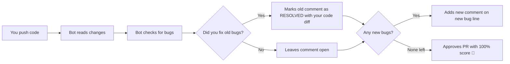

# PR Bot Comment & Fix Guide (Simple & Easy)

---

## 1. Quick Summary (What does this bot do?)

When you open a Pull Request (PR), this bot acts like an automated code reviewer:
1. **Finds bugs** in your code and leaves comments with suggested fixes.
2. **Shows a single scorecard** at the top of the PR with a health grade (A, B, C, F).
3. **Recognizes your fixes:** When you fix a bug in a new commit, the bot updates the old comment to **`[RESOLVED ✅]`** and shows the exact code you added to fix it!
4. **No spam:** It updates existing comments instead of creating duplicate comments on every push.

---

## 2. How It Works (Simple Diagram)



---

## 3. Real-Life Scenarios (Step-by-Step)

### Scenario 1: You open a PR with 2 bugs
* **What happened:** You open a PR with two problems: Bug A on Line 20 and Bug B on Line 65.
* **What the bot does:**
  * Shows **one review box** with your scorecard (Score: 50%, Grade C, "Changes Requested").
  * Adds **two comments** right next to Line 20 and Line 65 with suggested code fixes.

---

### Scenario 2: You fix 1 bug, but leave 1 bug unfixed (Partial Fix)
* **What happened:** You fixed Bug A (Line 20), but forgot to fix Bug B (Line 65).
* **What the bot does:**
  * **Bug A comment:** Automatically changes to **`✅ [RESOLVED]`** and displays the code you added.
  * **Bug B comment:** Stays open (no duplicates created).
  * **Scorecard:** Health score goes up (e.g., 50% $\rightarrow$ 75%).
  * **Verdict:** Still "Changes Requested" because Bug B is still not fixed.

---

### Scenario 3: You fix a bug, but accidentally create a new bug
* **What happened:** You fixed Bug B, but while editing, you made a new mistake on Line 110 (Bug C).
* **What the bot does:**
  * **Bug B comment:** Updates to **`✅ [RESOLVED]`** with your fix.
  * **Bug C:** Gets a **fresh new comment** on Line 110 explaining the new problem.
  * **Scorecard:** Recalculates your score for the new bug.
* **Why this is helpful:** You get immediate confirmation that your first fix worked, while seeing the new mistake you need to fix.

---

### Scenario 4: A bug you already fixed comes back (Regression)
* **What happened:** You fixed Bug A earlier. Later, another commit accidentally brings back Bug A on Line 20.
* **What the bot does:**
  * The old resolved comment stays as history showing you fixed it before.
  * Because the bug is back in the code, the bot adds a **new active comment** on Line 20 warning you that the bug returned.
  * Score drops back down to protect the project.

---

### Scenario 5: You add lines above a bug (Line Shift)
* **What happened:** You added 10 lines of comments at the top of the file. This pushed Bug B from Line 65 down to Line 75. You did not fix the bug.
* **What the bot does:**
  * The bot realizes the code only shifted down.
  * It keeps the original comment active and does **not** post a duplicate comment.

---

### Scenario 6: You delete the whole file that had the bug
* **What happened:** You decided you don't need `OldService.cs` anymore, so you deleted it.
* **What the bot does:**
  * Marks the old comment as **`✅ [RESOLVED - File Removed]`**.
  * Clears that bug from the scorecard.

---

### Scenario 7: All bugs are fixed (100% Clean PR)
* **What happened:** You fixed every single issue.
* **What the bot does:**
  * Every comment is marked **`✅ [RESOLVED]`** with the code changes shown.
  * Scorecard reaches **100/100 (Grade A - Perfect Score ✨)**.
  * Bot changes its status to **`APPROVED` 🟢**.
  * The green **Merge Pull Request** button is unlocked!

---

## 4. Easy Progress Table (How a PR moves commit-by-commit)

| Commit | What You Did | Old Bug A (Line 20) | Old Bug B (Line 65) | New Bug C (Line 110) | Score | PR Status |
| :---: | :--- | :---: | :---: | :---: | :---: | :---: |
| **Commit 1** | Opened PR with 2 bugs | 🚨 Open | 🚨 Open | — | 50% (C) | 🔴 Changes Requested |
| **Commit 2** | Fixed Bug A | ✅ **RESOLVED** | 🚨 Open | — | 75% (B) | 🔴 Changes Requested |
| **Commit 3** | Fixed Bug B, added Bug C | ✅ Resolved | ✅ **RESOLVED** | 🚨 Open | 75% (B) | 🔴 Changes Requested |
| **Commit 4** | Bug A brought back by mistake | 🚨 Re-opened | ✅ Resolved | 🚨 Open | 50% (C) | 🔴 Changes Requested |
| **Commit 5** | Fixed Bug A and Bug C | ✅ **RESOLVED** | ✅ Resolved | ✅ **RESOLVED** | 100% (A) | 🟢 **APPROVED 🎉** |

---

## 5. What the Comments Look Like

### When the bot finds a bug:
> 🔴 **[HIGH] Missing check on user input**
> 
> **Problem:** Variable `id` can be negative or 0.
> **Suggested Fix:**
> ```suggestion
> if (id <= 0) return BadRequest("Invalid ID");
> ```

---

### When you fix the bug (Bot updates the comment):
> ### ✅ [RESOLVED] Issue Fixed in commit `a1b2c3d`
> 
> **Code added to fix:**
> ```diff
> + if (id <= 0)
> +     return BadRequest("Invalid ID");
> ```
> 
> ---
> <details>
> <summary>Click to view original bug report</summary>
> 
> 🔴 [HIGH] Missing check on user input...
> </details>

---

## 6. How to block merging until all comments are resolved

If you want GitHub to stop anyone from merging until all bot comments are resolved:
1. Go to your GitHub repository $\rightarrow$ **Settings** $\rightarrow$ **Branches**.
2. Click your branch (e.g., `main`).
3. Check the box: **"Require conversation resolution before merging"**.
4. Now, GitHub will block the merge button until all comments are marked resolved!
