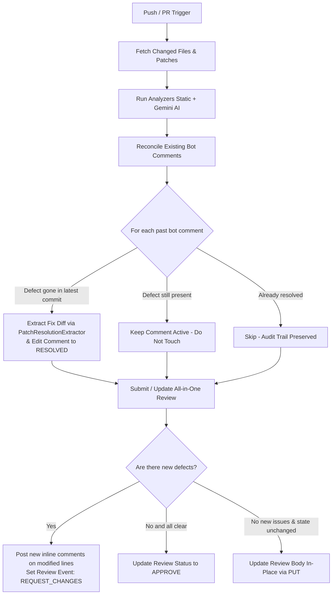

# PR Bot Comment Lifecycle & Resolution Guide

---

## 1. Overview

This document describes the complete lifecycle of code review comments posted by the **Universal PR Bot**, including:
- **In-Place Comment Updates:** How previously reported defects are automatically detected as fixed and updated to `[RESOLVED ✅]` with the developer's applied code diff.
- **All-in-One Review Block:** How the top-level Review Dashboard scorecard and inline code comments are unified into a single review, preventing timeline pollution.
- **Deduplication & Idempotency:** How re-runs and subsequent pushes avoid posting duplicate comments or redundant review cards.

---

## 2. Core Architecture & Workflow Diagram



---

## 3. Detailed Scenarios & Behavior Matrix

### Scenario 1: Initial PR Review (New Defects Found)
* **Trigger:** PR is opened or initial push is made.
* **Condition:** Analyzers identify defects at or above configured thresholds (e.g., Critical/High priority).
* **Behavior:**
  1. Each finding receives a hidden tracking marker: `<!-- pr-bot-finding:file={path}:line={line} -->`.
  2. The bot creates an **All-in-One Review** (`POST /repos/{owner}/{repo}/pulls/{number}/reviews`):
     - **Review Body:** Full Markdown Review Dashboard containing Code Health Scorecard, Grade, Verdict Alert Banner, and Defect Breakdown.
     - **Review Event:** `REQUEST_CHANGES` (or `COMMENT` if only low/advisory findings).
     - **Review Comments:** Inline comments attached directly to the offending lines in the *Files changed* tab.
* **PR Timeline Result:** Exactly **one review block** appears on the PR containing both the dashboard and the inline comments.

---

### Scenario 2: Developer Fixes Defect (Issue Resolved)
* **Trigger:** Developer edits the code to fix the issue and pushes a new commit (`pull_request: synchronize`).
* **Condition:** The analyzer re-scans the file and no longer flags any defect around that line.
* **Behavior:**
  1. **Detection:** In `ReconcileResolvedCommentsAsync`, the bot matches the prior comment to the modified file. Because the defect is no longer reported, it is marked as resolved.
  2. **Diff Extraction:** `PatchResolutionExtractor` inspects the unified Git diff (`file.Patch`) for the file around that line number and extracts the newly added lines (`+ ...`).
  3. **In-Place Comment Update:** The bot calls `ReviewComment.Edit` to update the original inline comment:
     - Changes header to: `### ✅ [RESOLVED] Issue Fixed in commit <sha>`.
     - Inserts the exact code diff added by the developer.
     - Collapses the original issue report into a `<details>` dropdown.
     - Appends `<!-- pr-bot-resolved -->` to prevent redundant future edits.
  4. **Status Update:** If all blocking defects are resolved, the bot updates the Review status to **`APPROVE`** and updates the health score to Grade A (100%).

---

### Scenario 3: Developer Fixes Old Defect, But Introduces a New Bug
* **Trigger:** Developer pushes a commit that resolves the original bug on Line 40, but introduces a new problem on Line 75.
* **Condition:** Defect on Line 40 is gone, but a new defect is detected on Line 75.
* **Behavior:**
  1. **Old Comment (Line 40):** Edited in-place to `[RESOLVED ✅]` showing the code diff of the fix.
  2. **New Comment (Line 75):** A fresh inline comment is posted on Line 75 with the problem description and fix suggestion.
  3. **Review Dashboard:** The single Review Dashboard updates its scorecard:
     - Recalculates Code Health Score based on the new defect.
     - Quality Gate remains `FAILED ❌`.
     - Review event remains `REQUEST_CHANGES`.
* **Developer Experience:** Clear, immediate feedback: confirms the first fix worked, while highlighting the new bug that needs attention.

---

### Scenario 4: Developer Pushes Commit That Does Not Fix the Defect
* **Trigger:** Developer pushes documentation changes, or an attempt to fix that did not resolve the underlying issue.
* **Condition:** Analyzer continues to report the defect at or near the original line.
* **Behavior:**
  1. **Comment Retained:** The existing comment is left untouched and active.
  2. **No Duplicate Comment:** The deduplication logic checks `existingComments` against the finding snippet and marker. The bot logs:
     `Skipping already reported comment on File (Line X)`
     and **does not post a duplicate comment**.

---

### Scenario 5: Subsequent Re-run with Zero Code Changes (Idempotency)
* **Trigger:** GitHub Actions workflow is manually re-run, or PR is reopened without new commits.
* **Condition:** Review state is unchanged, and `inlineComments.Count == 0`.
* **Behavior:**
  1. The bot detects `stateUnchanged == true` and `inlineComments.Count == 0`.
  2. It updates the existing review body in-place via `PUT /repos/{owner}/{repo}/pulls/{number}/reviews/{review_id}`.
  3. **Zero new review blocks** or notification spam are created.

---

### Scenario 6: Handling Comments Already Marked Resolved
* **Trigger:** Any subsequent commit or re-run after a comment was previously resolved.
* **Condition:** Comment body contains `<!-- pr-bot-resolved -->` or `[RESOLVED]`.
* **Behavior:**
  1. The reconciliation loop immediately skips the comment:
     ```csharp
     if (comment.Body.Contains(ResolvedMarker) || comment.Body.Contains("[RESOLVED]"))
     {
         continue;
     }
     ```
  2. The resolution audit trail and code diff remain permanently preserved.

---

## 4. Visual Comment Templates

### Template A: Newly Posted Inline Finding
```markdown
🔴 **[HIGH] Missing input validation on user-controlled parameters**

**Category:** Reliability & Security
**Problem:** Parameter `id` is directly parsed without range check.
**Suggested Fix:**
```suggestion
if (id <= 0) return BadRequest("Invalid ID");
```

<sub>Reported by GeminiReviewAnalyzer</sub>
<!-- pr-bot-finding:file=Services/OrderService.cs:line=42 -->
```

---

### Template B: Updated Comment After Developer Resolves Issue
```markdown
### ✅ [RESOLVED] Issue Fixed in `e5a1b2c`

**Code changes applied to resolve:**
```diff
@@ -40,4 +40,5 @@ public async Task<IActionResult> GetOrder(int id)
+    if (id <= 0)
+        return BadRequest("Invalid ID");
     return Ok(await _repo.GetAsync(id));
```

---
<details>
<summary>Original Finding</summary>

🔴 **[HIGH] Missing input validation on user-controlled parameters**
...
</details>

<!-- pr-bot-resolved -->
```

---

## 5. Summary of Key Files

| File | Role |
| :--- | :--- |
| **`src/PR_Bot.Core/Services/IPatchResolutionExtractor.cs`** | Interface for Git unified diff hunk parsing. |
| **`src/PR_Bot.Core/Services/PatchResolutionExtractor.cs`** | Implementation that locates the matching hunk and extracts code additions (`+ ...`) around the target line. |
| **`src/PR_Bot.Core/Services/IGitHubService.cs`** | Contract defining `ReconcileResolvedCommentsAsync` and `PostReviewAsync`. |
| **`src/PR_Bot.Core/Services/GitHubService.cs`** | Coordinates in-place comment editing, resolution reconciliation, and the unified All-in-One Review posting. |
| **`src/PR_Bot.Action/Program.cs`** | Orchestrates the PR Bot execution pipeline. |
| **`tests/PR_Bot.Core.Tests/Services/PatchResolutionExtractorTests.cs`** | Unit tests for diff hunk extraction and line matching. |
| **`tests/PR_Bot.Core.Tests/Services/GitHubServiceResolutionTests.cs`** | Unit tests verifying in-place resolution editing, skipping resolved comments, and review handling. |

---

## 6. GitHub Branch Protection Integration

To enforce that all bot review comments must be resolved before merging:
1. In your GitHub repository, navigate to **Settings** $\rightarrow$ **Branches** $\rightarrow$ **Branch protection rules** (or **Rulesets**).
2. Select your default branch (e.g. `main`).
3. Enable **"Require conversation resolution before merging"**.
4. With this enabled, GitHub requires all conversation threads opened by the bot to be resolved before the **Merge** button becomes active.
