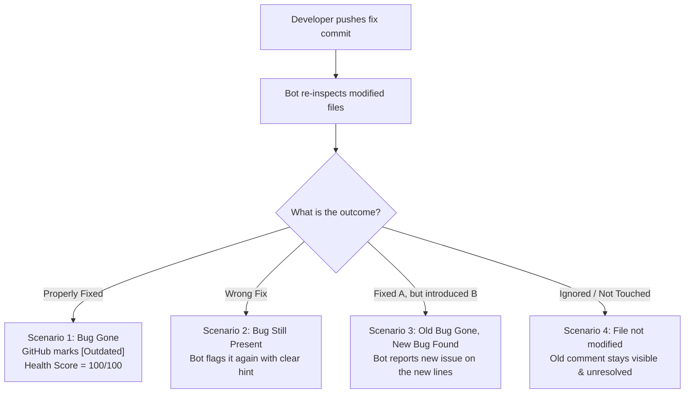

# Incremental Code Review Approach (Delta Review)

---

## 1. What Is the Incremental Approach?

In simple terms:  
**The incremental approach (or delta review) means the review bot ONLY reviews the *new changes* introduced in the latest commit, instead of re-reading the entire pull request from scratch.**

### Real-Life Analogy:
Imagine you submit a 10-page essay to your teacher.
- On Page 4, your teacher finds a spelling mistake and asks you to fix it.
- You correct that one word on Page 4 and hand it back.
- **Normal Teacher (Incremental):** Looks only at Page 4 to verify your correction. Once verified, gives you an A+.
- **Annoying Teacher (Non-Incremental):** Re-reads all 10 pages from the beginning, changes their mind about Page 1, finds a new issue on Page 8, and asks you to re-do those too!

The **Incremental Approach** ensures the bot behaves like the normal teacher.

---

## 2. Why Is It Used? (What Problem Does It Solve?)

| Without Incremental Review (Current / Full PR) | With Incremental Review (Delta Approach) |
| :--- | :--- |
| Every time you push a fix commit, the bot re-analyzes **all files** across the entire PR. | The bot only reviews the **files and lines you touched in that commit**. |
| The bot can "change its mind" and add new comments on files you didn't even touch. | Files you didn't touch are **never** re-reviewed. |
| Takes 6–10 API calls on every commit (burns quota/tokens). | Takes only 1–2 API calls (saves 80%+ tokens and quota). |
| CI/CD builds take longer (1–2 minutes). | CI/CD reviews finish in seconds (5–10s). |

---

## 3. How It Works (Step-by-Step Workflow with Example)

### Simple Scenario:
You are working on a PR with **3 files**:
1. `Controllers/AuthController.cs`
2. `Services/AuthService.cs`
3. `Models/LoginRequest.cs`

---

### Step 1: Initial PR Open (`opened`)
- You open the PR.
- Because this is the **first time**, the bot does a **Full Review** across all 3 files.
- The bot finds **1 issue** in `Services/AuthService.cs`:
  > *"Line 52: SecureStringEquals returns true on mismatched length. Please fix."*
- The other 2 files (`AuthController.cs` and `LoginRequest.cs`) are completely fine.

---

### Step 2: You Fix the Issue & Push Commit #2
- You open `Services/AuthService.cs`, fix the return value on line 52, and commit:
  ```bash
  git commit -m "fix: correct password length comparison in AuthService"
  git push
  ```
- Notice: You did **NOT** touch `AuthController.cs` or `LoginRequest.cs`.

---

### Step 3: Incremental Review Runs (`synchronize`)
- The GitHub Action triggers on the new commit.
- The bot asks GitHub:  
  *“What files changed between Commit #1 (`before`) and Commit #2 (`head`)?”*
- GitHub responds:  
  *“Only `Services/AuthService.cs` was modified (1 line changed).”*
- **The bot sends ONLY `Services/AuthService.cs` to Gemini!**
- `AuthController.cs` and `LoginRequest.cs` are completely skipped.

---

### Step 4: The Result
- Gemini inspects the fix in `Services/AuthService.cs`.
- The fix is correct, so Gemini returns **0 errors**.
- The bot outputs:
  > *"✨ All checks passed! Clean commit. 🎉"*
- **Result:** You are done! No 6–7 commit loop.

---

## 4. Pros & Cons (Advantages vs. Disadvantages)

### ✅ Pros (Advantages)

1. **Stops the Infinite Review Loop:**
   - The bot will never introduce surprise comments on files that were already accepted in earlier commits.
2. **Huge Token & Quota Savings:**
   - If a PR has 10 files and you fix 1 line in 1 file, the bot makes **1 AI request instead of 10 requests**.
   - Prevents `429 TooManyRequests` (quota exceeded) errors on AI Studio.
3. **Much Faster CI/CD Builds:**
   - The bot finishes in 3–5 seconds instead of waiting 40+ seconds for all files to be evaluated.
4. **Better Developer Experience:**
   - Developers feel that their fixes are actually respected and verified, rather than having the bot move the goalposts.

---

### ⚠️ Cons (Disadvantages & Limitations)

1. **Cannot Detect Cross-File Side Effects:**
   - If you change a method signature in `AuthService.cs` (e.g., adding a new parameter), and that breaks a caller in `AuthController.cs`, the bot will not notice unless `AuthController.cs` was also modified in that commit.
   *(Note: The compiler `dotnet build` already catches signature breaks in CI).*
2. **Dependent on Git Commit History:**
   - If a developer performs a `git push --force` with a squashed rebase, the `before` commit SHA might no longer exist in the branch history. In that scenario, the bot must safely fall back to a full review.
3. **First-Run Misses Stay Missed:**
   - If the bot missed a subtle issue in an untouched file on Run 1, it will not catch it on Run 2 unless someone modifies that file again.

---

## 5. Summary: When to Use Which?

| Event | Review Type | What It Checks |
| :--- | :--- | :--- |
| **PR Opened / Reopened** | **Full PR Review** | Every modified file in the entire PR (thorough first pass). |
| **New Commits (`synchronize`)** | **Incremental (Delta) Review** | Only the specific files modified in that commit. |
| **Manual Trigger (`/review-all`)** | **Full PR Review** | Forces a complete review of all files on demand. |

---

## 6. How to Know If Old Comments Are Resolved (All Scenarios)

When a developer pushes changes, there are **4 possible outcomes** for the reported comments:



---

### Scenario 1: The Issue Was Successfully Fixed (Ideal Case)
- **What Happened:** The developer fixed the bug on line 52 correctly.
- **How GitHub Shows It:**
  1. GitHub compares the new commit with the old comment line.
  2. Because the code was changed, GitHub marks the comment thread as **`[Outdated]`** and automatically collapses it.
- **How the Bot Knows:**
  1. Gemini re-evaluates the modified file and returns **0 findings**.
  2. The bot updates the sticky summary comment at the top of the PR:
     ```text
     🩺 Code Health Score: 100/100 [Grade: A+ (Excellent)]
     | Status | Priority Level | Issues |
     |:------:|:---------------|:------:|
     | ✅ | 🔴 High Priority | 0 |
     | ✅ | 🟡 Medium Priority | 0 |
     | ✅ | 🟢 Low Priority | 0 |
     ✨ All code quality and security issues have been resolved! Clean PR. 🎉
     ```
  3. No new inline comments are posted.
- **Result:** **Resolved.** The PR is ready to merge.

---

### Scenario 2: The Issue Was Fixed Incompletely or Incorrectly
- **What Happened:** The developer edited line 52, but the logic is still flawed (e.g. inverted check or wrong variable).
- **How GitHub Shows It:**
  1. The old comment becomes `[Outdated]` because the line was touched.
- **How the Bot Knows:**
  1. The bot inspects the new lines.
  2. Gemini detects that the defect is still present.
  3. The bot posts a new comment on the updated line:
     > *"🤖 Gemini AI Review 🔴 [HIGH PRIORITY]: The length comparison is still inverted on line 52..."*
  4. The summary table keeps the score low (e.g., 50/100) and displays `🔴 High Priority: 1`.
- **Result:** **Not Resolved.** The developer immediately knows the fix was incomplete.

---

### Scenario 3: The Fix Introduced a New Bug
- **What Happened:** The developer fixed the length comparison, but introduced an unhandled `NullReferenceException` on the line right next to it.
- **How GitHub Shows It:**
  1. The original comment is marked `[Outdated]`.
- **How the Bot Knows:**
  1. Gemini sees that the original issue is fixed, so it does **not** complain about the length check.
  2. But it spots the new null reference risk on the newly added line and reports it.
  3. Health score reflects the new issue.
- **Result:** **Old issue resolved, new issue flagged.**

---

### Scenario 4: The Developer Ignored the Comment (Did Not Touch the File)
- **What Happened:** The bot flagged an issue in `AuthService.cs`, but the developer only committed changes to `README.md` or `AuthController.cs`.
- **How GitHub Shows It:**
  1. Because `AuthService.cs` was not modified in the commit, the original comment thread remains **Active (NOT Outdated)**.
  2. The unresolved thread stays clearly visible in the PR conversation.
- **How the Bot Knows:**
  1. Under the incremental approach, the bot compares `before_sha..head_sha`.
  2. It sees `AuthService.cs` was not touched, so it does not waste tokens on it.
  3. The original comment remains open and visible on GitHub until the file is fixed.
- **Result:** **Not Resolved.** Remains active on GitHub.

---

## 7. Developer Verification Checklist (How to Check in 5 Seconds)

| Indicator | Where to Look | What to Check |
| :--- | :--- | :--- |
| **1. GitHub Comment Status** | PR Conversation Tab | Old comment should have a gray badge: **`[Outdated]`**. |
| **2. Bot Summary Table** | Top comment of PR | Health Score should be **100/100**; High & Medium issues = **0**. |
| **3. New Inline Comments** | PR Files Changed Tab | **No new comments** posted on the lines you just changed. |
| **4. GitHub CI Check** | Bottom of PR (Checks) | The PR Bot workflow should be green: **`✅ Automated Code Review — Successful`**. |
