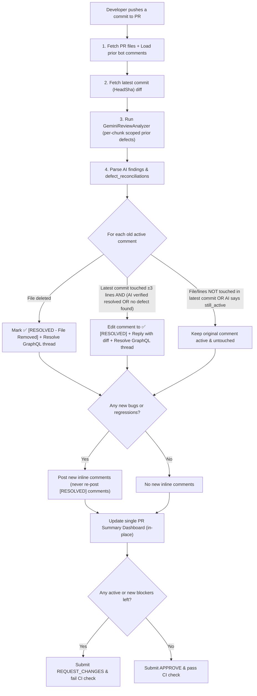

# How PR_Bot Works: Complete Comment & Resolution Flow

This document explains how **PR_Bot** reviews Pull Requests, tracks old bugs across commits, marks fixed bugs as `✅ [RESOLVED]`, keeps unfixed bugs active, and handles newly introduced bugs.

---

## 1. End-to-End Flow (Per Commit / Re-Run)

---

## 2. Step-by-Step: Your Exact Scenario (2 Bugs → 1 Fixed, 1 Active → 1 New Bug Added)

Suppose you open a PR with **2 bugs** in `Controllers/TagsController.cs`:
* **Bug A (Line 53):** `Guid.NewGuid()` in `Create()`
* **Bug B (Line 63):** Bulk delete loop in `Delete()`

### Commit 1: PR Opened (2 Bugs Found)
* **What PR_Bot does:**
  1. Posts **2 inline comments** (`#9001` at Line 53, `#9002` at Line 63) with `<!-- pr-bot-finding:file=...:line=... -->`.
  2. Posts **1 Summary Dashboard** at the top (`PR Review: Merge Blocked`, `2 active issues`).
  3. Submits **`REQUEST_CHANGES`**.

---

### Commit 2: You Fix Bug A (Line 53), Leave Bug B (Line 63) Unfixed, AND Add Bug C (Line 35)
* **What PR_Bot does on re-run:**
  1. **Loads Prior Comments (`PopulatePriorDefectsAsync`):**
     * Loads `#9001` (Line 53) and `#9002` (Line 63) as active prior defects.
     * Skips any thread reply comments (`InReplyToId != null`) so resolved replies are never double-counted.
  2. **Checks Latest Commit (`HeadSha`) Diff (`ReconcileResolvedCommentsAsync`):**
     * **Bug A (Line 53):** Latest commit modified Line 53 (`±3` lines) and AI verified the fix →
       * Edits `#9001` in-place to **`### ✅ [RESOLVED]`** and stores `<!-- pr-bot-resolved:commit=<sha2> -->`.
       * Replies with `✅ Resolved in <sha2>.` and the `Changes that fixed it` diff.
       * Resolves `#9001` in GitHub UI via GraphQL.
     * **Bug B (Line 63):** Latest commit did **not** touch Line 63 (`|53 - 63| = 10 > 3`), and AI marks it `still_active` →
       * `#9002` stays **active and untouched** (preserves thread history, no duplicate posted).
     * **Bug C (Line 35):** Newly detected in `TagsController.cs` →
       * Posted as a **new inline comment** (`#9003`) at Line 35.
  3. **Updates Summary Dashboard (`BuildReviewMarkdown`):**
     * **Active findings:** Bug B (Line 63) + Bug C (Line 35).
     * **Verified fixes:** Bug A (Line 53) — `(Fixed in <sha2>)`.
     * **Review verdict:** Still **`REQUEST_CHANGES`**.

---

### Commit 3: You Fix Bug B (Line 63) and Bug C (Line 35)
* **What PR_Bot does on re-run:**
  * **Bug A (Line 53):** Already has `[RESOLVED]` → skipped; keeps its original `Fixed in <sha2>` SHA.
  * **Bug B (Line 63) & Bug C (Line 35):** Both edited to `### ✅ [RESOLVED]` with `Fixed in <sha3>`, diff replies posted, and threads resolved via GraphQL.
  * **Summary Dashboard:** Shows `✅ 3 verified fixes` (`Bug A` in `<sha2>`, `Bug B` and `Bug C` in `<sha3>`), `0` active issues.
  * **Review verdict:** **`APPROVE`** 🎉.

---

## 3. All Other Scenarios at a Glance

| Scenario | What Happens |
| :--- | :--- |
| **New commit touches a different file** | Old active bugs in untouched files stay **active** (latest commit diff check prevents false resolution). |
| **AI hallucinates `"resolved"` on an untouched line** | Rejected by the `lineWasModified` guard in `GitHubService` and contradiction check in `GeminiReviewAnalyzer`. |
| **Regression (resolved bug is reintroduced later)** | Bot keeps the old `[RESOLVED]` comment as history and posts a **fresh active comment** on that line. |
| **File with active bug is deleted** | Old comment is marked **`### ✅ [RESOLVED - File Removed]`** and the thread is resolved. |
| **Unfixed bug shifts > 10 lines down** | Matched by file + title (`sameTitleInFile`) so it is **not** falsely marked resolved. |
| **Developer clicks "Resolve conversation" in GitHub UI without fixing code** | Ignored by the bot — defect remains active until the code is actually fixed. |
